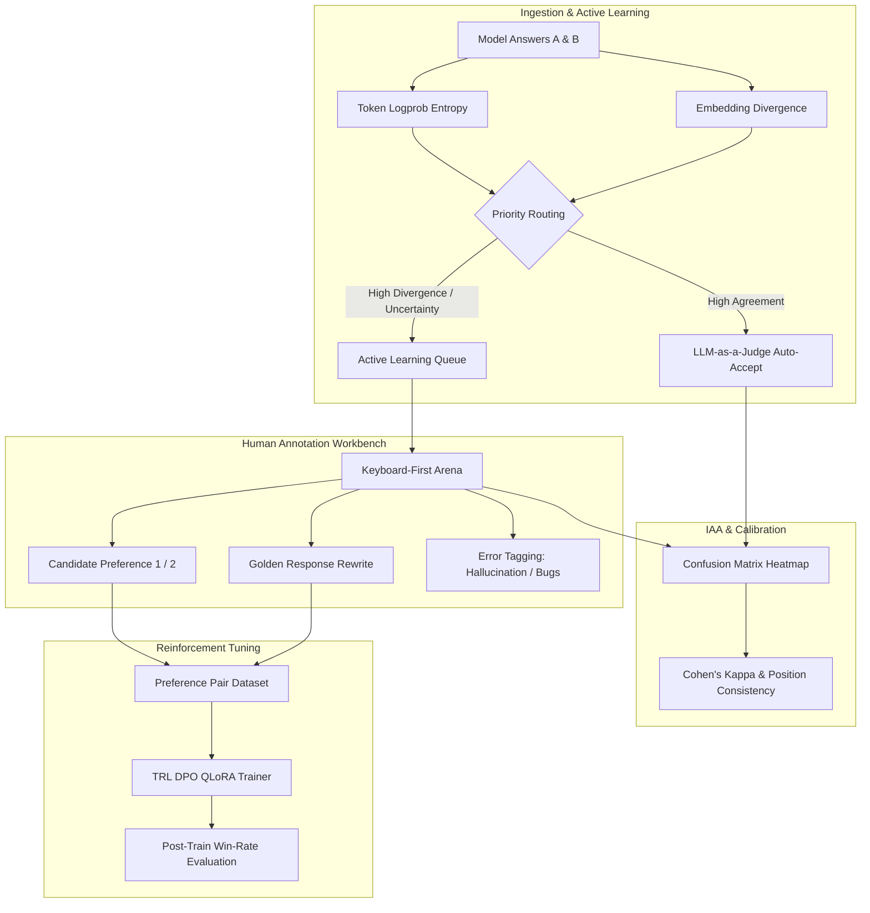

# AlignForge — Rank, Fix, and Train AI

<p align="center">
  
  
  
  
  
  
</p>

> **A live platform where humans and AI judges compare model answers, fix mistakes, and train smarter AI in one click.**

AlignForge is a complete, production-grade active-learning alignment studio. When language models produce tough responses, AlignForge generates candidate pairs, calculates token entropy and semantic divergence to prioritize the hardest edge cases, routes trivial decisions to an automated position-calibrated LLM judge, and empowers human reviewers to craft golden rewrites. Once enough feedback is gathered, it launches Direct Preference Optimization (DPO) and measures post-training win rates with 95% Wilson confidence intervals.

---

## Key Capabilities

- **Active-Learning Prioritization Queue (70%+ Cost Reduction)**:
  Measures candidate logprob entropy and embedding cosine divergence ($1 - \cos(\mathbf{e}_A, \mathbf{e}_B)$). Reviewers only see high-uncertainty cases where human judgment yields maximum gradient impact.
- **Keyboard-First Side-by-Side Arena**:
  Instant keyboard shortcuts (`1`, `2`, `T`, `X`, `S`, `R`, `Enter`) with side-by-side rendering, rubric scoring (Helpfulness, Accuracy, Safety, Conciseness), error flagging (Hallucinations, Bugs, Policy Violations), and golden response rewrites.
- **LLM-as-a-Judge Calibration & Cohen's Kappa**:
  Tests for first-position bias using bidirectional position-swap evaluation ($A/B$ vs $B/A$). Calculates Cohen's Kappa ($\kappa$) with bootstrap confidence intervals and confusion matrix heatmaps.
- **Direct Preference Optimization (DPO) Pipeline**:
  Constructs pure preference pairs (golden rewrites strictly outrank model answers; ties dropped). Fine-tunes QLoRA adapters using HuggingFace TRL and evaluates post-training win rates against baseline.
- **40 Pre-Seeded Golden Prompts**:
  Ships with 40 benchmark prompts across Python/TypeScript Coding, Multi-Step Reasoning, Olympiad-Style Math, Complex Instruction-Following, and Science.

---

## Architecture Overview



---

## Quickstart

### Option 1: Docker Compose (All Services)

```bash
# Clone the repository
git clone https://github.com/master72o/rank-fix-and-train-ai.git
cd rank-fix-and-train-ai

# Start Postgres (pgvector), Redis, FastAPI backend, and Next.js frontend
docker compose up -d

# Seed the 40 golden benchmark prompts
docker compose exec backend python scripts/seed_golden_dataset.py
```

The web application is live at:
- Frontend: `http://localhost:3000`
- API Documentation (Swagger): `http://localhost:8000/docs`

---

### Option 2: Local Development

#### 1. Backend Setup
```bash
cd backend
python -m venv .venv
source .venv/bin/activate  # Or on Windows: .venv\Scripts\activate
pip install -e ".[dev,ml,llm]"

# Seed database
python scripts/seed_golden_dataset.py

# Start FastAPI dev server
uvicorn app.main:app --reload --port 8000
```

#### 2. Frontend Setup
```bash
cd ../frontend
npm install
npm run dev
```
Open `http://localhost:3000` in your browser.

---

## Keyboard Shortcuts

| Shortcut | Action |
|:---:|---|
| <kbd>1</kbd> | Choose **Candidate A** (Left) as superior |
| <kbd>2</kbd> | Choose **Candidate B** (Right) as superior |
| <kbd>T</kbd> | Mark interaction as **Equal / Tie** |
| <kbd>X</kbd> | Mark interaction as **Both Bad** |
| <kbd>S</kbd> | **Swap visual positions** (counters position bias) |
| <kbd>R</kbd> | Open **Golden Response Rewrite** editor |
| <kbd>Enter</kbd> | **Submit & Advance** to next sample |

---

## Active Learning Priority Formulation

Priority scores $P \in [0, 1]$ are computed per candidate pair:

$$P = w_e \cdot \frac{H_A + H_B}{2} + w_d \cdot D_{\text{semantic}} + w_l \cdot \min(1, |\ln(L_A / L_B)|)$$

Where:
- $H$: Mean token logprob entropy ($-\frac{1}{T}\sum p_t \log p_t$).
- $D_{\text{semantic}}$: Cosine distance ($1 - \frac{\mathbf{e}_A \cdot \mathbf{e}_B}{\|\mathbf{e}_A\| \|\mathbf{e}_B\|}$).
- $L_A / L_B$: Candidate response token length ratio.

---

## Inter-Annotator Agreement (Cohen's Kappa)

Cohen's Kappa $\kappa$ measures true agreement between human annotators and automated judges:

$$\kappa = \frac{P_o - P_e}{1 - P_e}$$

- $P_o$: Observed percentage of identical verdicts.
- $P_e$: Expected agreement by chance based on marginal rating distributions.
- **Landis & Koch Benchmark**: $\kappa > 0.60$ validates automated LLM judge auto-acceptance.

---

## REST API Reference

| Method | Endpoint | Description |
|---|---|---|
| `GET` | `/api/v1/prompts/queue` | Fetch active-learning prioritized review queue |
| `GET` | `/api/v1/prompts/queue/stats` | Queue statistics, priority distribution, cost savings |
| `POST` | `/api/v1/prompts/` | Ingest new prompt and candidate pair |
| `POST` | `/api/v1/annotations/` | Submit human preference, rubric scores, and golden rewrite |
| `POST` | `/api/v1/judge/evaluate` | Trigger automated LLM judge with position-swap bias check |
| `GET` | `/api/v1/judge/agreement` | Compute Cohen's Kappa, confusion matrix, and CI report |
| `POST` | `/api/v1/training/runs` | Launch DPO QLoRA training run |
| `GET` | `/api/v1/training/runs` | List training runs, loss histories, and win rates |
| `GET` | `/api/v1/training/preference-pairs` | Preview formatted chosen vs rejected DPO training pairs |

---

## Testing

```bash
cd backend
pytest tests/ -v
```

AlignForge test suite covers:
- Active learning entropy and semantic divergence scoring.
- Cohen's Kappa against `scikit-learn` gold standard calculations.
- Landis & Koch interpretation thresholds.
- Bootstrap 95% confidence intervals.
- Position consistency rate logic under A/B and B/A swapping.

---

## License

This project is licensed under the [MIT License](LICENSE).
